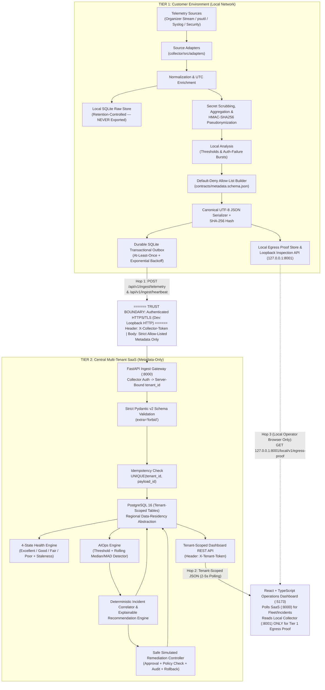

# AegisOps System Architecture

Product: **AegisOps** — *"Observe everything. Expose nothing."*

## 1. Two-Tier Architecture Overview

AegisOps separates telemetry processing into two physically and logically isolated tiers so that sensitive operational records never cross the customer trust boundary.

## 2. Labeled Network Hops

| Hop | Source -> Destination | Protocol & Auth | Payload | Trust Boundary Crossed? |
| :--- | :--- | :--- | :--- | :---: |
| **Hop 0** | Local Telemetry Sources -> Collector Adapters | Local process / loopback / configured stream | Raw telemetry (may contain secrets, IPs, hostnames) | No (Inside Tier 1) |
| **Hop 1** | Tier 1 Collector Outbox -> Tier 2 SaaS Ingest (`:8000/api/v1/ingest/*`) | HTTPS/TLS in deployment (loopback HTTP in local dev); `X-Collector-Token` | Canonical UTF-8 JSON conforming strictly to `metadata.schema.json` or `heartbeat.schema.json` | **YES (Primary Trust Boundary)** |
| **Hop 2** | Tier 2 SaaS Backend -> PostgreSQL (`saas-internal` network) | TCP 5432 on isolated Docker bridge (`saas-internal`) | Validated tenant-scoped metadata only | No (Inside Tier 2) |
| **Hop 3** | Operator Browser -> Tier 2 SaaS API (`:8000/api/v1/*`) | HTTPS/HTTP; `X-Tenant-Token` | Tenant-scoped aggregates, incidents, recommendations, SaaS receipt hashes | Operator Boundary |
| **Hop 4** | Operator Browser (Local Admin) -> Tier 1 Collector Inspection API (`127.0.0.1:8001/local/v1/*`) | Local loopback ONLY | Local raw events vs canonical outbound JSON & SHA-256 hash | **NEVER crosses to SaaS** |

## 3. Telemetry Plan

Monitored domains and approved metric names (`contracts/metadata.schema.json`):
- **Infrastructure**: `cpu_usage_percent`, `memory_usage_percent`, `disk_usage_percent`, `service_availability_percent`
- **Network**: `network_bandwidth_mbps`, `network_latency_ms`, `network_packet_loss_percent`, `network_connectivity_status`
- **Security (Local-Analyzed Summaries Only)**: `failed_auth_attempts_count`, `suspicious_activity_score`
- **Collector Self-Health**: `collector_queue_depth`, plus heartbeat metrics (`collector_cpu_percent`, `collector_memory_mb`, `pending_outbox_count`, `retry_count`)

## 4. Four-State Health Model

Evaluated deterministically with configurable thresholds and strict precedence:
1. **`Poor` (Critical)** — Highest precedence: collector offline (`> 60s` since heartbeat), critical metric breach (`cpu >= 95%`, `memory >= 95%`, `packet_loss >= 10%`, `service_availability < 95%`), or critical security burst (`failed_auth_attempts_count >= 20`).
2. **`Fair` (Needs Attention)** — Collector heartbeat stale (`45s..60s`), elevated resources (`cpu >= 80%`, `memory >= 80%`, `latency >= 150ms`, `packet_loss >= 2%`), or recurring warnings.
3. **`Good` (Normal / Minor Variance)** — Collector online, minor baseline variance (`|robust_z| >= 2.0` without threshold breach) or soft warnings (`cpu >= 65%`, `latency >= 80ms`).
4. **`Excellent` (Healthy)** — Collector actively reporting (`<= 45s`), all metrics nominal and within baseline.

**Stale-Data Rule**: A stale or offline collector is **immediately downgraded** (`Fair` at 45s, `Poor` at 60s). Every state transition is logged with UTC timestamp, `reason_code`, and human-readable explanation.

## 5. AIOps Intelligence Pipeline

1. **Method A — Configurable Static Thresholds**: Deterministic operational bounds across CPU, memory, disk, latency, packet loss, availability, and auth failures.
2. **Method B — Rolling Median / MAD Statistical Baseline**:
   - Maintains a rolling window (e.g., last 30–60 event-time ordered points per `(tenant_id, source_id, metric_name)`).
   - Cold-start protection: requires at least `MIN_SAMPLES = 8` points before declaring a learned baseline. During cold start, marks baseline status as `"insufficient_history"` instead of fabricating deviations.
   - Computes `median`, `MAD = median(|x - median|)`, and `robust_z = 0.6745 * (x - median) / MAD`.
   - Zero-MAD protection: if `MAD == 0`, falls back to an explicit epsilon/delta rule (`|x - median| > min_absolute_delta`) rather than dividing by zero.
3. **Deterministic Incident Correlation**:
   - Groups anomalies sharing `(tenant_id, environment_id)` within a configurable correlation window (default 5 minutes) when signals are operationally linked (same `source_id`, or resource + network/service cascade in the same environment).
   - Never merges unrelated events solely due to timestamp proximity (e.g., an unrelated security auth burst on another environment remains separate).
4. **Explainable Recommendations & Evidence Score**:
   - Deterministic evidence score (`0..100`) using a transparent, displayed formula:
     `score = min(100, 30 * min(distinct_signal_types, 2) + 20 * (1 if baseline_confirmed else 0) + 20 * severity_weight)`
   - Every recommendation lists contributing `payload_id`s, UTC timestamps, detector responsible, probable explanation, suggested investigation, expected benefit, and explicit risk/uncertainty.
5. **5-Stage Roadmap to Autonomous Ops**:
   - Stage 1 Observe -> Stage 2 Detect -> Stage 3 Correlate -> Stage 4 Recommend -> Stage 5 Act (**Simulated only in 24-hour prototype**: policy check -> human operator approval -> immutable audit record -> rollback plan).

## 6. Global-Ready Design & Scalability

- **Regional Ingest Abstraction**: Every tenant and collector carries an explicit `region_id` (`ap-south-1`, `eu-central-1`, `us-east-1`, `us-west-2`). The ingest gateway validates that a collector is posting to its tenant's assigned region (configurable single deployed region in the hackathon, cleanly ready for regional cluster deployment).
- **Time Handling**: All timestamps stored as UTC `TIMESTAMPTZ`, paired with `source_timezone`. Charts query `ORDER BY event_time_utc ASC`, isolating ingestion arrival delays from trend accuracy.
- **Scalability Path**: Modular monolith backend + stateless ingest workers + PostgreSQL time-partitioned `telemetry_events` table (partitioned by `tenant_id` / day) + local collector SQLite outbox buffering handles high collector fan-in without requiring Kafka or Kubernetes for the 24-hour prototype.
